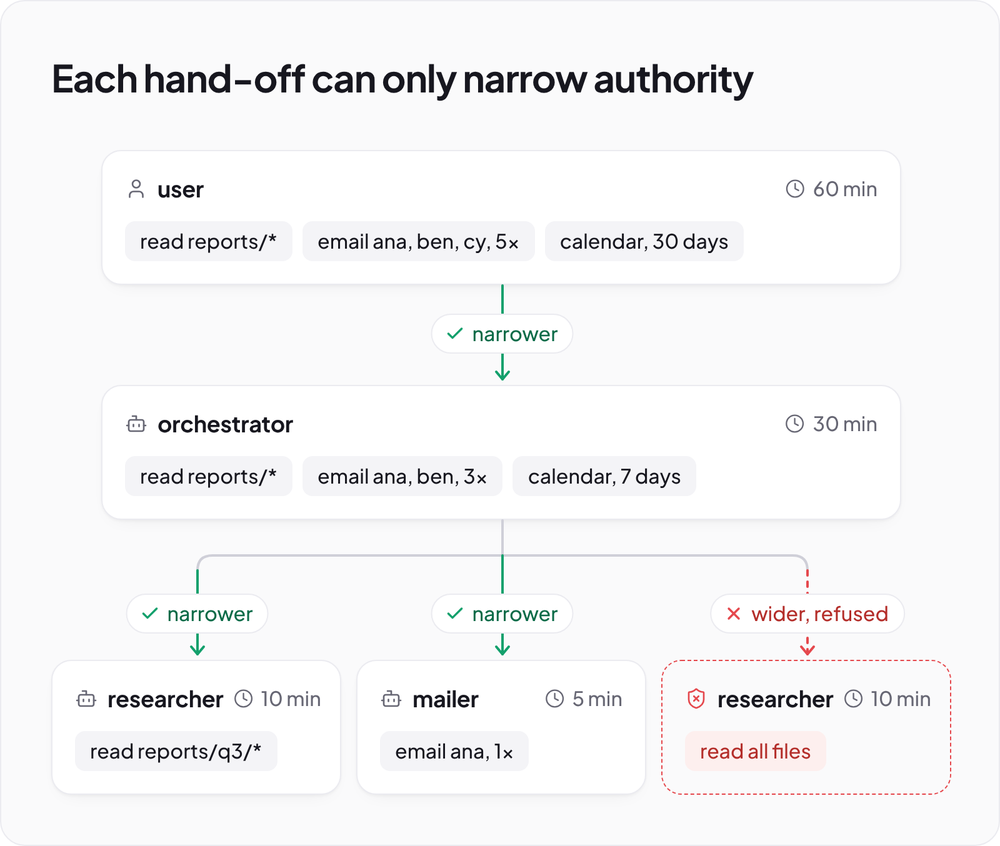

# toolgate



toolgate is an authorization gateway for LLM agents: a component outside the model that checks every tool call against an explicit, narrow grant.
An agent can hand a sub-agent a weaker grant, never a stronger one.
The model does not decide what it is allowed to do.

**Status: early. Only the capability model (milestone M0) exists.** There are no tokens, no policy engine, no audit log, no server and no MCP proxy yet. The plan and the design decisions are in [docs/PLAN.md](docs/PLAN.md).

## What works today

A grant is a set of capabilities and an expiry. A capability names one tool and constrains its arguments with five operators (`eq`, `in`, `max`, `glob`, `any`). Decisions fail closed: an unknown tool, a missing argument, an argument the capability does not name, or an unknown operator means deny.

```python
from toolgate import Call, Grant, check_attenuation

parent = Grant.from_dict(
    {
        "expires_at": 1_800_003_600,
        "capabilities": [
            {
                "tool": "read_file",
                "args": {"path": {"glob": "reports/*"}},
            }
        ],
    }
)
child = Grant.from_dict(
    {
        "expires_at": 1_800_000_600,
        "capabilities": [
            {
                "tool": "read_file",
                "args": {"path": {"glob": "reports/q3/*"}},
            }
        ],
    }
)

check_attenuation(parent, child).ok  # True
check_attenuation(child, parent).ok  # False
child.allows(Call("read_file", {"path": "reports/q3/a.txt"}), 1_800_000_000)  # True
child.allows(Call("read_file", {"path": "reports/q1/a.txt"}), 1_800_000_000)  # False
```

## Results so far

The security invariant: if the attenuation check accepts a child grant, every call the child allows is also allowed by the parent.

| Measure | Value |
|---|---|
| Generated (parent, child, call) cases | 20,000 |
| Child grants accepted by the check | 12,688 |
| Cases where the accepted child allows the call, so the invariant is actually exercised | 4,993 |
| Violations of the invariant | 0 |
| Deliberately broken versions of the check detected by the same test | 11 of 11 |

Produced by `python scripts/m0_invariant.py` (seed 0); output in [results/m0_invariant.json](results/m0_invariant.json). The figure above is produced by `python scripts/fig_delegation_tree.py`, and every arrow in it is a real call to the check.

What these numbers do and do not show:

- This is random testing, not a proof. Zero violations in 20,000 cases is evidence, and the 11 detected seeded bugs show the test can fail. A solver-based check of the rules is the next milestone.
- The check is sound by design but not complete: it rejects some child grants that would be safe, for example a child that is only covered by two parent capabilities together. The size of that gap has not been measured yet.
- `glob` is string matching with `*` as the only special character. It does not understand paths, so `reports/../x` matches `reports/*`. A tool that takes file paths must canonicalize them first.
- Call budgets (`max_calls`) are compared during attenuation but not yet enforced, because counting calls needs the token layer.
- Inputs must be plain JSON data. Objects of other types are rejected.

## Development

```bash
pip install -e ".[dev]"
```

```bash
pytest
```

```bash
ruff check . && ruff format --check .
```

The property tests run 10,000 examples each by default and take about a minute. Set `TOOLGATE_EXAMPLES=300` for a quick run.
