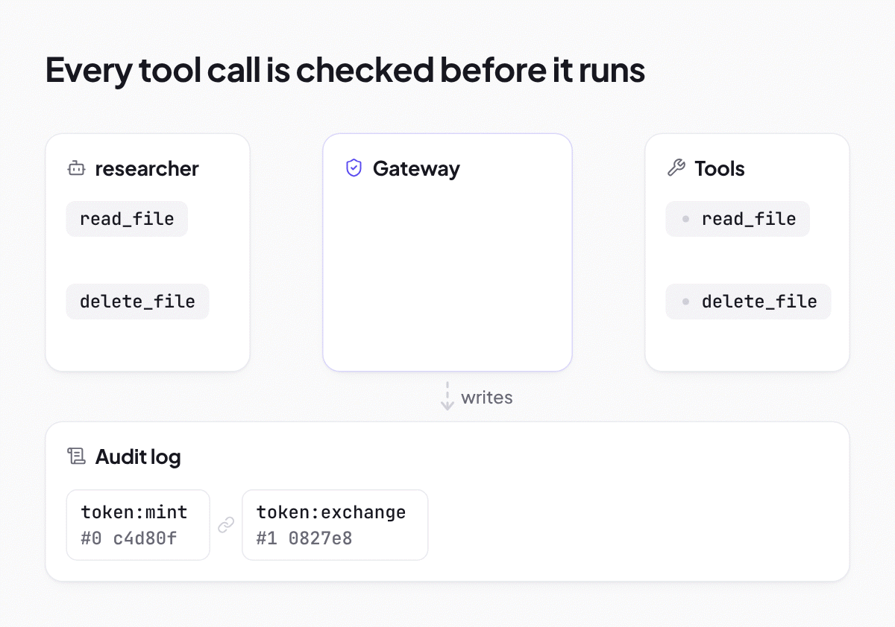
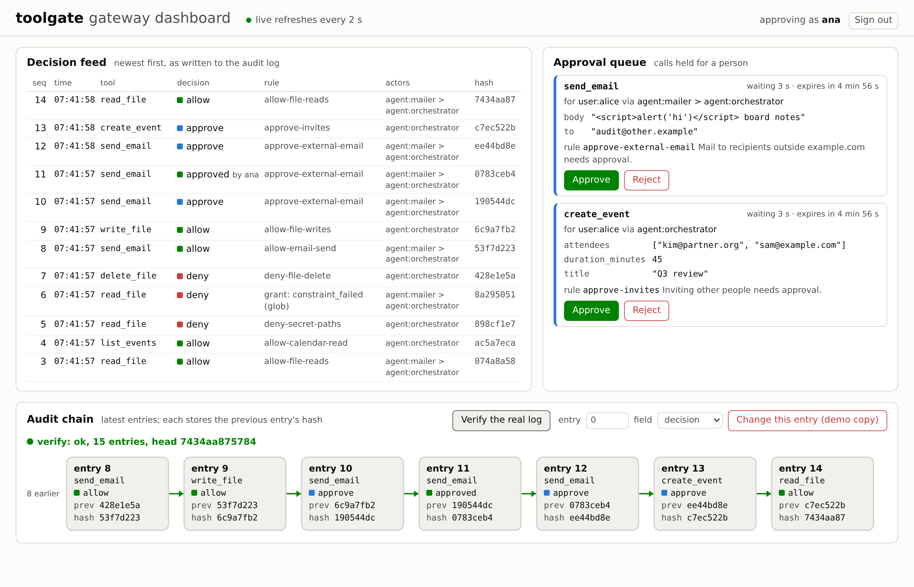
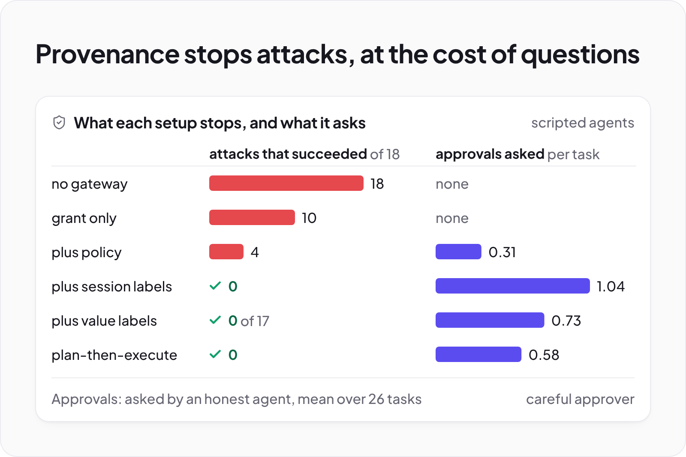

# caveat

An authorization gateway for LLM agents, where each hand-off can only narrow authority.

<p align="center">
  
</p>

caveat sits between an agent and its tools. Every tool call is checked against a short-lived, narrowly scoped grant and an operator policy, in code that runs outside the model. Sensitive calls wait for a person, and every decision is written to a hash-chained audit log before the tool runs.

## Why

An agent that calls tools usually holds one broad, long-lived credential. A web page or an email it reads can carry instructions, and the agent may follow them with the user's full authority. It passes the same credential to every sub-agent, and afterwards it is hard to say who allowed what.

caveat applies ordinary least privilege to that setup. A task gets a grant for the tools and argument values it needs, for a few minutes. An agent can exchange its token for a weaker one to give a sub-agent, never a stronger one. The name comes from macaroons, where caveats are restrictions a holder can add but never remove.

## Example

Grants can be used as a plain library, with no server:

```python
from caveat import Call, Grant, check_attenuation

parent = Grant.from_dict(
    {
        "expires_at": 1_800_003_600,
        "capabilities": [{"tool": "read_file", "args": {"path": {"glob": "reports/*"}}}],
    }
)
child = Grant.from_dict(
    {
        "expires_at": 1_800_000_600,
        "capabilities": [{"tool": "read_file", "args": {"path": {"glob": "reports/q3/*"}}}],
    }
)

assert check_attenuation(parent, child).ok
assert not check_attenuation(child, parent).ok
assert child.allows(Call("read_file", {"path": "reports/q3/a.txt"}), 1_800_000_000)
assert not child.allows(Call("read_file", {"path": "reports/q1/a.txt"}), 1_800_000_000)
```

A grant is closed-world: every argument of a call must be named by a constraint, and every constraint must hold. The constraint operators are `eq`, `in`, `max`, `glob` and `any`.

## How a call is decided

`Gateway.handle_call` in [src/caveat/gateway.py](src/caveat/gateway.py) is the only path to a tool. The HTTP server and the MCP proxy are thin adapters over it. Every step fails closed.

1. Canonicalize arguments the operator has typed (paths, emails, URLs), or refuse ambiguous ones.
2. Verify the token: Ed25519 signature, issuer, audience, expiry, and revocation of the token and all its ancestors.
3. Check the call against the grant.
4. Check it against the policy. Deny beats approve beats allow, and no matching rule means deny.
5. If a rule asks for approval, park the call, bound to the exact request. When a person approves, the checks run again on the stored call.
6. Charge the call budget to the capability and every ancestor in one atomic operation.
7. Append and fsync the audit entry. If that fails, refund the charge and do not run the tool.
8. Recheck expiry and revocation, then run the tool on the canonical copy of the arguments.

The reasons behind the order and the other design choices are in the decision log at the end of [docs/PLAN.md](docs/PLAN.md#decision-log).

## What is in the box

The core is a capability model and the attenuation check that decides whether one grant is narrower than another. On top of it sit signed tokens (Ed25519 JWTs with exchange, revocation and a shared call budget), offline chain tokens that a holder can narrow without contacting the gateway, a YAML policy language, and the audit log.


The gateway runs as a FastAPI service or as a proxy in front of an MCP server. The proxy shows a client only the tools its token allows and sends every `tools/call` through the same pipeline.

The audit log is a hash chain in JSON Lines. Editing any entry makes verification fail at that entry, provided the reader trusts a published head hash.


Provenance tracking is optional. With session labels, everything an agent produces after reading untrusted content is treated as untrusted, and the policy can require approval before it leaves. Value labels track individual values through handles, and a plan-then-execute mode keeps untrusted data out of the plan.

An admin dashboard (off by default) shows the decision feed, the approval queue and the audit chain.



## How it is checked

The attenuation check has one property that matters: if it accepts a child grant, the child allows nothing the parent does not. That property is covered by property-based tests, including deliberately broken versions of the check that the tests must catch. Each rule is also proved sound with the Z3 SMT solver, with the rules as modeled; the Python code is tied to the model by differential tests. The check is sound and deliberately incomplete, and the gap is measured. Figures are in [results/invariant.json](results/invariant.json), [results/rules_proof.json](results/rules_proof.json) and [results/completeness.json](results/completeness.json).

To see whether the layers stop anything, there is a sandbox: a toy office world with email, calendar, files and web fetches, and hand-written tasks run by scripted agents. Eight tasks are ordinary work. In 18 others, a document or page carries an injected instruction, and the hijacked agent obeys it and retries when refused. With no gateway, every attack succeeds. With grants, policy and session labels, and an approver who approves only what the user asked for, none succeed and all eight ordinary tasks still complete. With an approver who approves everything, eight attacks get through. These are counts from a scripted toy, not rates for real agents. Full results are in [results/scripted_eval.json](results/scripted_eval.json).

Stronger tracking asks a person more often. Once an agent has read untrusted content, everything it writes is labeled untrusted, which is called label creep:




The same tasks were also run once with real models as the agent, kept separate from the scripted results. Claude Sonnet 5.5 never acted on an injected instruction. Claude Haiku 4.5 acted on two: with no gateway both went through, the policy's approval rule stopped one, and session labels stopped both. In a few tasks the injected text never reached the model. This is a handful of cases from a single pass, and it does not measure how often a real model is hijacked. See [results/real_model_sonnet.json](results/real_model_sonnet.json), [results/real_model_haiku.json](results/real_model_haiku.json) and [docs/REAL_MODEL_RUN.md](docs/REAL_MODEL_RUN.md).

On a shared cloud container, the gateway adds a median of about 0.3 ms to an allowed call with a reused token and audit fsync on, mostly the fsync ([results/latency.json](results/latency.json)).

## Quick start

Python 3.11 or later.

```bash
pip install -e ".[dev]"
pytest -q
```

Run the gateway. Both secrets come from environment variables. Read [docs/DEPLOYMENT.md](docs/DEPLOYMENT.md) before listening on anything but loopback.

```bash
export CAVEAT_SIGNING_KEY="$(openssl rand -base64 32)"
ADMIN_KEY="$(openssl rand -base64 32 | tr '+/' '-_' | tr -d '=')"
export CAVEAT_ADMIN_KEY_SHA256="$(printf %s "$ADMIN_KEY" | sha256sum | cut -d' ' -f1)"
python -m caveat.server --config config/gateway.example.yaml   # 127.0.0.1:8000
```

In a second shell with the same `ADMIN_KEY`, mint a token, then call the example tool with it:

```bash
curl -s -X POST localhost:8000/token -H "Authorization: Bearer $ADMIN_KEY" \
  -H 'Content-Type: application/json' \
  -d '{"sub":"user:alice","actor":"agent:demo","expires_in":600,
       "capabilities":[{"tool":"echo","args":{"text":{"any":true}}}]}'
curl -s -X POST localhost:8000/call -H "Authorization: Bearer $TOKEN" \
  -H 'Content-Type: application/json' -d '{"tool":"echo","args":{"text":"hi"}}'
curl -s localhost:8000/audit/verify -H "Authorization: Bearer $ADMIN_KEY"
```

`TOKEN` is the `token` field of the first response. The call is denied by policy: the grant allows `echo`, but `config/policy.example.yaml` has no rule for it, and both must agree. Audit logs can be checked offline with `python -m caveat.audit verify <path> --head <hash>`.

To put the gateway in front of an MCP server, run `python -m caveat.mcp_proxy --config <file> --upstream <url>`. The config's `audience` must be the proxy's own MCP URL; `examples/mcp_upstream_server.py` is a small server to try it with. `scripts/demo_dashboard.py` starts the gateway with the dashboard on.

## Reproducing the results

```bash
bash scripts/reproduce_all.sh      # several minutes
```

This regenerates every file under `results/` and every figure under `assets/`. Figures are HTML pages under `scripts/design/` rendered by headless Chromium through Node.js Playwright, so they need Node 18 or later and `npm i -D playwright && npx playwright install chromium` in the repo root (or `CAVEAT_NODE_PATH` pointing at an existing install). Apart from the latency benchmark and the dashboard screenshots, reruns are identical byte for byte. The real-model evaluation needs an API key and is not part of the script.

The seeds and key seeds in `scripts/` are fixed, public demo values so that reruns match byte for byte; never reuse them, or any key derived from them, outside the demos.

## Limits

- Tokens are bearer tokens. There is no proof of possession (DPoP), so a stolen token works until it expires or is revoked.
- There is one shared admin key. The log records "by admin", and the approver name is whatever the key holder types. Actor names in `act` are attribution only.
- `glob` is string matching with `*` as its only special character, and it knows nothing about paths. Safety depends on per-tool canonicalization, which the operator configures; path canonicalization is lexical and cannot see symbolic links.
- Labels follow data, not control flow. Which branch ran, whether a call happened, and which handle or field the agent picked are not labeled.
- Labels attach to whole results, not fields, and are not stored with files: untrusted text written to a private folder reads back as trusted.
- Value labels assume a runtime that passes handles. Ordinary agents do not, unless they run plan-then-execute.
- Plan-then-execute is scripted here. The planner and the quarantined extractor are per-task functions, so they show the mechanism and say nothing about how well a model plans.
- Approvals are only as good as the person giving them, and stronger labeling asks more often.
- A tool that times out keeps running, because Python threads cannot be killed. It keeps its in-flight slot and its budget is not refunded.
- It runs on a single node. The store is in memory or one SQLite file; the approval queue, in-flight counters and unverified-token rate limit are in memory and lost on restart, which fails closed.
- Anything but loopback needs a reverse proxy for TLS, read timeouts, per-address limits and a body size limit. Path-based ACLs at the proxy must not be relied on ([docs/DEPLOYMENT.md](docs/DEPLOYMENT.md)).
- The audit chain is tamper-evident only against a trusted head. Without a published head or checkpoint, someone who can rewrite the file can truncate it or rebuild every hash. External anchoring is not built, and rotated files are not linked.
- Budgets have edge cases. First-fit derivation can strand budget, a limited capability does not cap an overlapping unlimited one, and offline chain tokens carry no budget.
- Expiry depends on the clock. A clock set backwards can revive an expired token.
- Policy conditions see top-level arguments only. `absent` and `any` on a deny or approve rule are presence tests the caller controls, and an approve rule opens a path to execution that no allow rule covers.
- The MCP proxy handles tools only (resources, prompts and sampling are refused), fixes the tool set at startup, passes tool descriptions and results through unchanged, and is not an OAuth authorization server.
- The attenuation check rejects some safe grants, and the proofs cover the rules as modeled, within the bounds stated in the results file.

## Related work

- The [MCP authorization spec](https://modelcontextprotocol.io/specification/2026-07-28/basic/authorization) makes an MCP server an OAuth resource server. The proxy follows it (RFC 9728 metadata, token audience bound to its own URL, no token passthrough) and adds per-call argument limits, delegation and approval.
- OAuth 2.0 Token Exchange (RFC 8693) and the IETF WIMSE delegation drafts (`draft-sweeney-wimse-credential-delegation`, `draft-asor-wimse-agent-delegation-chain`) describe the same invariants caveat enforces: narrowing at each hop, monotonic expiry, an unchanged principal, and `act` as attribution only.
- Macaroons (Birgisson et al., NDSS 2014) and [Biscuit](https://github.com/biscuit-auth/biscuit) are tokens whose holders can only add restrictions. The offline chain tokens follow both, with a much smaller caveat language and no Datalog.
- CaMeL ([Debenedetti et al., 2025](https://arxiv.org/abs/2503.18813)) separates a privileged planner from a quarantined model and tracks dependencies in its own interpreter. caveat borrows the plan-then-execute shape but enforces at the tool boundary, and does not claim CaMeL's guarantees.
- Cedar, OPA and Zanzibar are general policy engines or relationship-based systems; caveat's policy is a small YAML rule language for single tool calls on one node.

## Project layout

```
src/caveat/        the library, gateway, server, MCP proxy and dashboard
  sandbox/         toy world, tasks, scripted and model agents, runner
scripts/           one script per results file or figure, plus reproduce_all.sh
config/            example gateway config and policy, sandbox grants and policies
examples/          a small MCP server to put behind the proxy
docs/              design plan and decision log, deployment notes, real-model run
results/ assets/   saved outputs and figures
tests/
```

## License

MIT, see [LICENSE](LICENSE).
